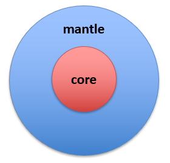

Tutorials
=========

Here, you will find a variety of tutorials.

Before proceeding, ensure that the SIR 3S Toolkit is properly installed (see :ref:`Installation <installing-toolkit-label>`). 

These tutorials are designed to introduce new users to the basic functionalities of the SIR 3S Toolkit. 

.. _tutorials-download-label:

Getting the tutorials
~~~~~~~~~~~~~~~~~~~~~

Each tutorial is a Jupyter notebook that comes with the SIR 3S models it uses. To run them, download them into a folder of your choice:

.. code-block:: bash

   python -m sir3stoolkit tutorials C:\Users\me\sir3stoolkit_tutorials

This downloads the tutorials of your installed sir3stoolkit version from its GitHub release and unpacks them into ``SIR3S_Model\TutorialNNN_Assets`` (tutorials 0 - 49) and ``SIR3S_Model_Mantle\TutorialNNN_Assets`` (tutorials 50 - 99); ``--only core`` or ``--only mantle`` downloads one group. Run the notebooks from there - they change their models and write calculation results next to them. If you have stored your SirGraf folder with ``wrapper.Write_SirGraf_Config_Path()`` (see Tutorial 0), it is set in the notebooks (``SIR3S_SIRGRAF_DIR``); otherwise pass it with ``--sirgraf-dir`` or set it in each notebook. Files that already exist are kept unless you add ``--overwrite``. Available from version 90.15.27 on.

.. _Ttu1-49:

SIR3S_Model()
~~~~~~~~~~~~~

The SIR3S_Model() class implements basic functionalities regarding interactions between Python and a SIR 3S model.

.. _Ttu000:

Tutorial 0: Importing and initialization of the SIR 3S Toolkit
^^^^^^^^^^^^^^^^^^^^^^^^^^^^^^^^^^^^^^^^^^^^^^^^^^^^^^^^^^^^^^

This tutorial demonstrates how to import the SIR 3S Toolkit and initialize instances of its classes.

View: `Notebook <tutorials/SIR3S_Model/Tutorial000_Assets/ToolkitTutorial000.html>`_.

.. _Ttu001:

Tutorial 1: Creating a new or opening an existing SIR 3S model
^^^^^^^^^^^^^^^^^^^^^^^^^^^^^^^^^^^^^^^^^^^^^^^^^^^^^^^^^^^^^^

This tutorial demonstrates how to create new SIR 3S models or open already existing ones.

View: `Notebook <tutorials/SIR3S_Model/Tutorial001_Assets/ToolkitTutorial001.html>`_.

.. _Ttu002:

Tutorial 2: Accessing and modifying model data
^^^^^^^^^^^^^^^^^^^^^^^^^^^^^^^^^^^^^^^^^^^^^^

This tutorial demonstrates how to get and set values of objects based on their topological key (tk).

View: `Notebook <tutorials/SIR3S_Model/Tutorial002_Assets/ToolkitTutorial002.html>`_.

.. _Ttu003:

Tutorial 3: Calculating and Accessing results
^^^^^^^^^^^^^^^^^^^^^^^^^^^^^^^^^^^^^^^^^^^^^

This tutorial demonstrates how to execute calculations and access their results.

View: `Notebook <tutorials/SIR3S_Model/Tutorial003_Assets/ToolkitTutorial003.html>`_.

.. _Ttu004:

Tutorial 4: Editing a SIR 3S using Transactions/EditSessions
^^^^^^^^^^^^^^^^^^^^^^^^^^^^^^^^^^^^^^^^^^^^^^^^^^^^^^^^^^^^

This Tutorial demonstrates how to change SIR 3S models by grouping changes into Transactions/EditSessions.

View: `Notebook <tutorials/SIR3S_Model/Tutorial004_Assets/ToolkitTutorial004.html>`_.

.. _Ttu005:

Tutorial 5: Insert and Connect Elements
^^^^^^^^^^^^^^^^^^^^^^^^^^^^^^^^^^^^^^^

This Tutorial demonstrates how new elements such as nodes, pipes, tanks, valves, etc. can be inserted into a SIR 3S model and connected.

View: `Notebook <tutorials/SIR3S_Model/Tutorial005_Assets/ToolkitTutorial005.html>`_.

.. _Ttu006:

Tutorial 6: Tables
^^^^^^^^^^^^^^^^^^

This Tutorial demonstrates how to view SIR 3S tables in python and add rows to them. For time tables some more advanced features are available: :ref:`Tutorial 54 <_Ttu054>`

View: `Notebook <tutorials/SIR3S_Model/Tutorial006_Assets/ToolkitTutorial006.html>`_.

.. _Ttu007:

Tutorial 7: Groups
^^^^^^^^^^^^^^^^^^

This Tutorial demonstrates how to obtain the tks of objects that are part of a Group (Layer) and to change which objects are part of which groups.

View: `Notebook <tutorials/SIR3S_Model/Tutorial007_Assets/ToolkitTutorial007.html>`_.

.. _Ttu008:

Tutorial 8: Miscellaneous
^^^^^^^^^^^^^^^^^^^^^^^^^^

This Tutorial demonstrates miscellaneous functions of the SIR3S_Model() class that cannot be assigned to one of the previous Tutorial topics. Including: GetHydraulicProfileObjectString(), GetCourseOfHydraulicProfile(), SetLogFilePath(), Set_Raise_On_Error(), EnableOrDisableOutputComments(), AllowSirMessageBox()

View: `Notebook <tutorials/SIR3S_Model/Tutorial008_Assets/ToolkitTutorial008.html>`_.

.. _Ttu009:

Tutorial 9: Model Validation
^^^^^^^^^^^^^^^^^^^^^^^^^^^^

This Tutorial demonstrates how to perform a model validation, checking a model for irregularities in modeling such as missing references of connecting elements to nodes.

View: `Notebook <tutorials/SIR3S_Model/Tutorial009_Assets/ToolkitTutorial009.html>`_.

.. _Ttu010:

Tutorial 10: Calculation Settings
^^^^^^^^^^^^^^^^^^^^^^^^^^^^^^^^^

This tutorial demonstrates how to change the calculation type, time frame, thermal settings, and working directory. In addition the manual editing of the XML-Calculation file will be demonstrated. This allows to configure different calculations for one model and seperate them into different directories.

View: `Notebook <tutorials/SIR3S_Model/Tutorial010_Assets/ToolkitTutorial010.html>`_.

.. _Ttu50-99:

SIR3S_Model_Mantle()
~~~~~~~~~~~~~~~~~~~~

SIR3S_Model_Mantle() is a collector class that extends the SIR3S_Model() class.

Most of these tutorials use *Network 3*, a fictional district heating network built from scratch with the SIR 3S Toolkit by `Network3.py <https://github.com/3SConsult/sir3stoolkit/blob/main/docs/source/networks/Network3.py>`_; it comes with the tutorials (see :ref:`Getting the tutorials <tutorials-download-label>`).

.. _Ttu050:

Tutorial 50: Mantle Import
^^^^^^^^^^^^^^^^^^^^^^^^^^

This Example demonstrates how to instantiate the SIR3S_Model_Mantle() class and its subclasses.

View: `Notebook <tutorials/SIR3S_Model_Mantle/Tutorial050_Assets/ToolkitTutorial050.html>`_.

.. _Ttu051:

Tutorial 51: Manual Creation of Element Dataframes
^^^^^^^^^^^^^^^^^^^^^^^^^^^^^^^^^^^^^^^^^^^^^^^^^^

This Example demonstrates the capabilities of the class SIR3S_Model_Dataframes that extends SIR3S_Model be abilities to work directley with pandas dataframes. It is shown how to create dataframes containing information about elements such as Nodes, Pipes, etc. existing in a SIR 3S Model. The methods presented are manual, user-defined and detailed. It also shows how to look up an element type - its properties, result properties with standard units, category and how to create it. For creating more general dataframes with less input necessary, see :ref:`Tutorial 52 <_Ttu052>`.

View: `Notebook <tutorials/SIR3S_Model_Mantle/Tutorial051_Assets/ToolkitTutorial051.html>`_.

.. _Ttu052:

Tutorial 52: General Creation of Element Dataframes
^^^^^^^^^^^^^^^^^^^^^^^^^^^^^^^^^^^^^^^^^^^^^^^^^^^

This Example demonstrates the capabilities of the class SIR3S_Model_Dataframes that extends SIR3S_Model be abilities to work directley with pandas dataframes. It is shown how to create dataframes containing information about elements such as Nodes, Pipes, etc. existing in a SIR 3S Model. The methods presented are not user-defined and neither efficient, but get you the most important information quickly. For more detailed methods of creating dataframes, see :ref:`Tutorial 51 <_Ttu051>`.

View: `Notebook <tutorials/SIR3S_Model_Mantle/Tutorial052_Assets/ToolkitTutorial052.html>`_.

.. _Ttu053:

Tutorial 53: Creation of  Longitudinal Section - and Edge Dataframe
^^^^^^^^^^^^^^^^^^^^^^^^^^^^^^^^^^^^^^^^^^^^^^^^^^^^^^^^^^^^^^^^^^^

This Example demonstrates the capabilities of the class SIR3S_Model_Dataframes that extends SIR3S_Model be abilities to work directley with pandas dataframes. It is shown how to create dataframes containing information that does not concern individual elements types such as Nodes, Pipes, etc. but instead concerning more abstract SIR 3S data such as longitudinal sections or concatenations of multiple element types like edges.

View: `Notebook <tutorials/SIR3S_Model_Mantle/Tutorial053_Assets/ToolkitTutorial053.html>`_.

.. _Ttu054:

Tutorial 54: Time Tables
^^^^^^^^^^^^^^^^^^^^^^^^

This example demonstrates how view, create, delete and edit measured variable tables (Sollwerttabellen) with pandas dataframes as python representation. The shown operations work for other time table types (["VarPressureTable", "VarFlowTable", "ValveLiftTable", "PumpSpeedTable", "MeasuredVariableTable", "LoadFactorTable", "ThermalOutputTable", "TemperatureTable"].) as well.

View: `Notebook <tutorials/SIR3S_Model_Mantle/Tutorial054_Assets/ToolkitTutorial054.html>`_.

.. _Ttu055:

Tutorial 55:  Compare Calculations
^^^^^^^^^^^^^^^^^^^^^^^^^^^^^^^^^^

The Tutorial demonstrates how to execute calculations for the same model in adjusted valve states and view the individual results.

View: `Notebook <tutorials/SIR3S_Model_Mantle/Tutorial055_Assets/ToolkitTutorial055.html>`_.

.. _Ttu056:

Tutorial 56:  Nominal Diamter Tables
^^^^^^^^^^^^^^^^^^^^^^^^^^^^^^^^^^^^

The Tutorial demonstrates how to view nominal diameter tables (Nennweitentabellen) and include their data in df_pipes.

View: `Notebook <tutorials/SIR3S_Model_Mantle/Tutorial056_Assets/ToolkitTutorial056.html>`_.

.. _Ttu057:

Tutorial 57: Bulk Result Read, Output Factors, and Time Curve Data
^^^^^^^^^^^^^^^^^^^^^^^^^^^^^^^^^^^^^^^^^^^^^^^^^^^^^^^^^^^^^^^^^^

This example demonstrates how to read calculation results quickly with generate_element_results_dataframe(bulk=True): instead of one Toolkit API call per value, the values are read directly from the result files (.MX1/.MX2/.MXS). It covers the bulk read and its memory limits, the two formats for interior-point results (str and multiindex) and how to merge them with model data, and output factors: which result file is read, how to check its contents with get_result_file_properties(), and how to read the time-curve data of the small output factor directly.

View: `Notebook <tutorials/SIR3S_Model_Mantle/Tutorial057_Assets/ToolkitTutorial057.html>`_.

.. _Ttu061:

Tutorial 61: Nx-Graph
^^^^^^^^^^^^^^^^^^^^^

This Tutorial demonstrates how to create a nx-Graph from a SIR 3S model.

View: `Notebook <tutorials/SIR3S_Model_Mantle/Tutorial061_Assets/ToolkitTutorial061.html>`_.

.. _Ttu062:

Tutorial 62: Pandapipes
^^^^^^^^^^^^^^^^^^^^^^^

This Tutorial demonstrates how to create a pandapipes model from a SIR 3S model.

View: `Notebook <tutorials/SIR3S_Model_Mantle/Tutorial062_Assets/ToolkitTutorial062.html>`_.

.. _Ttu071:

Tutorial 71: Time Curves
^^^^^^^^^^^^^^^^^^^^^^^^

This Tutorial demonstrates how to plot time curves.

View: `Notebook <tutorials/SIR3S_Model_Mantle/Tutorial071_Assets/ToolkitTutorial071.html>`_.

.. _Ttu072:

Tutorial 72: Longitudinal Sections (soon)
^^^^^^^^^^^^^^^^^^^^^^^^^^^^^^^^^^^^^^^^^

This Tutorial demonstrates how to plot time curves. WORK IN PROGRESS

View: `Notebook <tutorials/SIR3S_Model_Mantle/Tutorial072_Assets/ToolkitTutorial072.html>`_.

.. _Ttu073:

Tutorial 73: Network Color Depiction
^^^^^^^^^^^^^^^^^^^^^^^^^^^^^^^^^^^^

This example demonstrates how to plot network color depictions (ncd).

View: `Notebook <tutorials/SIR3S_Model_Mantle/Tutorial073_Assets/ToolkitTutorial073.html>`_.

.. _Ttu081:

Tutorial 81: Groups
^^^^^^^^^^^^^^^^^^^

This example demonstrates how add, remove, set elements to groups.

View: `Notebook <tutorials/SIR3S_Model_Mantle/Tutorial081_Assets/ToolkitTutorial081.html>`_.

..
   Examples
   --------

   These examples are intended for users who are already familiar with the basic functionality of the SIR 3S Toolkit and demonstrate how to apply it to real-world scenarios.

   Each example is available for both **viewing** and **downloading** as an `.ipynb` file. 

   .. _Tex1:

   Example 1: Shape Import
   ~~~~~~~~~~~~~~~~~~~~~~~

   This Example demonstrates how to create a connected topological network of nodes and pipes in SIR 3S via the SIR 3S Toolkit based on shapefile data. The data used comes from 'SIR 3S\Modelle\Beispiele\Wasser\Manual\Projektdaten\01 Shape-Dateien'.

   View: `Notebook <examples/Toolkit_Example001.html>`_ | Download: :download:`Notebook <examples/Toolkit_Example001.ipynb>`.

   .. _Tex2:

   .. Example 2: Iterate over SIR 3S calculations

   .. _TexX:

   Example X: Template
   ~~~~~~~~~~~~~~~~~~~

   .. admonition:: Contributor Template

      This is not a user-facing example but a template intended for contributors to create their own example.

   View: `Notebook <examples/Toolkit_ExampleX.html>`_ | Download: :download:`Notebook <examples/Toolkit_ExampleX.ipynb>`.

..
   Networks
   --------

   The networks are examples of SIR 3S model topologies.

   Each network is available for **previewing** and **downloading** as an `.py` file. You can open and run it using the Python Console in SIR 3S.

   .. _Tnw1:

   Network 1
   ^^^^^^^^^

   You can view the code below

   .. toggle::

      .. literalinclude:: Networks/Network1.py
         :language: python
         :linenos:

   You can download the Network file :download:`here <Networks/Network1.py>`.
